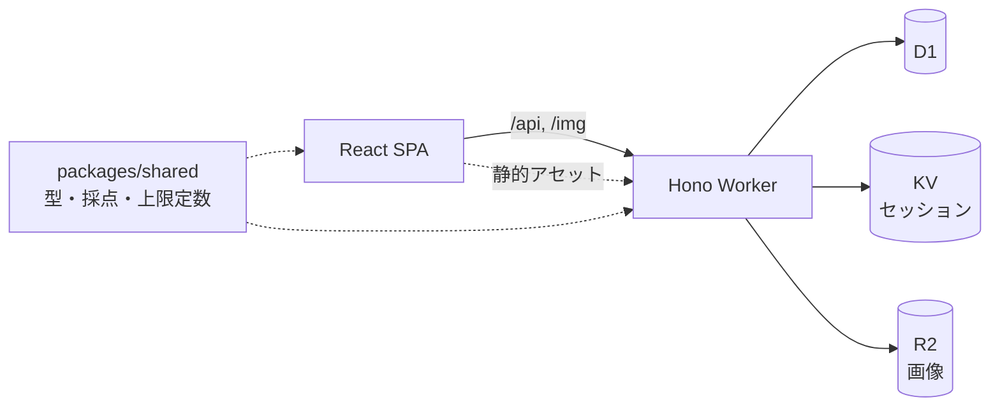

# Memorix

穴埋め形式のクイズを、誰でも作成・公開・プレイできる UGC（ユーザー生成コンテンツ）プラットフォーム。

## 概要

プリント教材のような「テキストの虫食い」や「表の空欄」を、チームで共同作成してそのまま公開できます。プレイする側はログイン不要で、回答は一括提出するとサーバー側で採点されます。正解データはプレイ用のレスポンスに含めない設計で、クイズの答えがクライアントから漏れないようにしています。公開後は通報の受付と運営（admin）によるモデレーションに対応します。

## 主な機能

- クイズ作成（Studio）: テキスト型・表型の問題に空欄を設定、画像の埋め込み、CSV 一括取り込み
- プレイ: ゲスト可、一括提出、サーバー採点、結果・履歴の表示、入力途中の回答の自動保存
- 発見: 科目別一覧、キーワード検索、フォロー、ブックマーク（フォルダ整理）
- チーム: クイズはチーム所有。チーム内ロールは owner / editor / viewer。招待リンク（ロール・期限・回数・失効を指定）
- 共有: 公開 / 限定公開（共有リンク）/ 非公開
- 認証: Google / Microsoft の OAuth
- 画像: クライアント側で圧縮してからアップロード、サイズ上限とチームごとの容量上限
- 運営（admin）: 科目の管理、通報の処理、クイズの強制非公開、ユーザー管理、統計
- 統計: クイズごとの回答状況の集計

## 技術スタック

| レイヤ | 技術 |
|---|---|
| ホスティング | Cloudflare Workers（API と静的アセットを単一 Worker で配信） |
| バックエンド | Hono + Zod |
| データ | Cloudflare D1 / KV（セッション）/ R2（画像） |
| フロントエンド | React 19 + Vite + Tailwind CSS + TanStack Query + React Router |
| 認証 | Google / Microsoft OAuth（`jose` で検証） |
| テスト | Vitest（`@cloudflare/vitest-pool-workers`）/ Playwright（axe-core によるアクセシビリティ検査含む） |
| 品質・ビルド | Biome / Turborepo / pnpm workspace / GitHub Actions |

## アーキテクチャ



- 採点ロジック（正規化・正誤判定）は `packages/shared` に置き、フロントとサーバーで型と定数を共有
- 権限チェックはリクエストごとに D1 を参照（KV にキャッシュしない）
- すべての書き込み API は Zod で入力検証

## セットアップと起動

前提: Node.js 24 以上、pnpm。

```bash
pnpm install
pnpm dev          # 開発サーバー（turbo run dev）
pnpm typecheck    # 型チェック
pnpm lint         # Biome
pnpm test         # 単体/結合テスト（Vitest）
pnpm build        # ビルド
pnpm test:e2e     # E2E（Playwright）
```

デプロイには Cloudflare 側で D1 / KV / R2 の作成が必要です。`apps/worker/wrangler.jsonc` の `database_id`、KV の `id`、`APP_ORIGIN` を各自の値に置き換えてください（現在は `<作成後に記入>` / `<account>` のプレースホルダ）。次のシークレットは `wrangler secret put` で設定します。

`GOOGLE_CLIENT_ID` / `GOOGLE_CLIENT_SECRET` / `MS_CLIENT_ID` / `MS_CLIENT_SECRET` / `ADMIN_EMAILS`（admin 権限を付与するメールのカンマ区切り）

`main` への push で GitHub Actions がテスト、D1 マイグレーション、デプロイを順に実行します（要 `CLOUDFLARE_API_TOKEN` / `CLOUDFLARE_ACCOUNT_ID`）。PR ではプレビュー版がアップロードされます。

## ディレクトリ構成

```
apps/
  worker/        Hono API・認証・admin（routes / middleware / lib / migrations / test）
  web/           React SPA（routes: ホーム・検索・プレイ・Studio・admin など）
  e2e/           Playwright E2E
packages/shared/ 型・採点ロジック・上限定数
templates/       CSV 取り込みテンプレート
.github/         CI/CD ワークフロー
```

設計文書: [memorix-plan-v3.md](./memorix-plan-v3.md)（企画・仕様）/ [memorix-implementation-spec-v1.md](./memorix-implementation-spec-v1.md)（実装仕様）

## Claude Code での開発

計画 → 実装 → 検証の順で、Claude Code と進めました。

- 計画: 先に企画書（v3）を確定し、決定事項を論点ごとの決定ログとして残した。そのうえで、実装エージェントが追加の意思決定なしで実装できることを狙った実装仕様書（D1 スキーマ全文、API 仕様、権限マトリクス、採点フロー、フェーズ別の完了条件）を作成
- 実装: 仕様書のフェーズ順（scaffold、認証 など）に実装。各フェーズ完了時に `typecheck` / `lint` / `test` を通す方針を仕様書に明記
- 検証: Worker 側に 12 本の Vitest（認証、権限、採点セッション、モデレーション、CSV、画像、統計など）、Playwright の E2E 5 本（ゲストプレイ、Studio の表・画像、ブックマーク移動、admin モデレーション、a11y）を用意し、CI でテストを通過してからデプロイ

## ライセンス

未定
